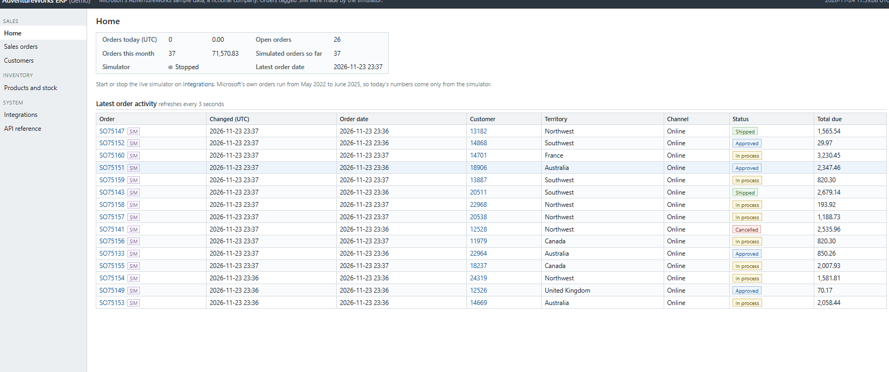

# AdventureWorks build log

One header per task from the planner, then what I did and saw underneath, then the screenshot.
New task: copy the empty block at the bottom and change the number and name.

To add a screenshot: Win+Shift+S, click under the header in Cursor, Ctrl+V. Cursor saves it in
`docs/screenshots/build/`. Rename it to start with the task number, e.g. `AW-2.3-first-api-call.png`.
Never capture a password or the API key (`.env`, the Integrations page with the key showing).

## AW 2.1 Looking around the ERP and familiarasing myself with it 

    On our home page it shows latest order activity, key info here is order number and customer. As the order number gives us our sales data, our customer data 

    Sales orders tab, showing the line of which the prd came from, Prd and its number, and other info regarding sales.

    Customer tab showing their previous orders, personal info, territory and account number 

    And laslty a product and stock 

## AW 1.1 WHAT ARE 5 QUESTIONS THE BUSINESS WANTS ANSWERED
    1. I would want to know how many sales we have each qaurter, (Target sales for the marketing team)
    2. Our most popular product (Push marketing out for it)
    3. Which area we are most popular in and a possible why IDk why im so obsesed with marekting but yeah 
    4. Based on the last 3 qaurters what can we expect for the next one hypothesis testing
    5. Total revenue 
    6. Time to delvier

## AW 1.2 Drawing how the data moves
    The data moves from 
            ERP data - Excrtaed via api via python script - 
            data warehouose - dbt for staging an schema = 
            dbt for warehouse schema - sql anlaysis - 
            python ststasitcal analysis regressional - 
                    visualisation 

## AW 1.3 Write down choices and why
    1.Chose Python API extraction instead of downlaoding a plain csv
        Its better for secirity, I dont have multiple tables of data sitting on my laptop
    2.using dbt instead of pandas
        it letd me manage sql transformations ina stuctered repeatred way

## AW 2.2 Looking at the ERP's tables in DBeaver

    

## AW 2.3 Trying the API by hand

    

## AW 2.4 The list of tables I'll copy

    
